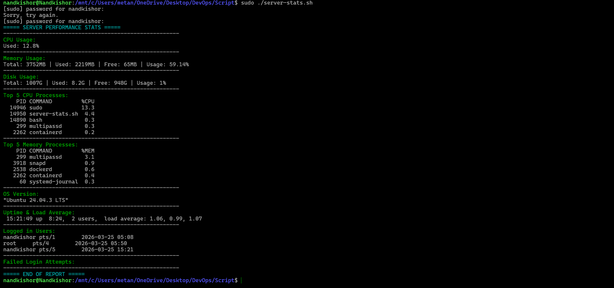

# 🚀 Server Performance Stats Script

## 🔗 Project URL:

https://roadmap.sh/projects/server-stats

🚀 A lightweight DevOps project demonstrating real-world Linux Monitoring using Bash Scripting.

* A simple and lightweight Bash Script to analyze basic server performance metrics on any Linux system.

* This project is designed to help DevOps Engineers, System Administrators, and Learners quickly understand server health without using heavy monitoring tools.

---

## 📌 Features

* ✅ CPU usage calculation
* ✅ Memory usage (Total, Used, Free, Percentage)
* ✅ Disk usage (Root partition)
* ✅ Top 5 processes by CPU usage
* ✅ Top 5 processes by Memory usage
* ✅ OS version detection
* ✅ System uptime and load average
* ✅ Logged-in users
* ✅ Failed login attempts (security insight)
* ✅ Clean and colored output

---

## 🛠️ Tech Stack

* Bash Scripting
* Linux Commands: `top`, `ps`, `df`, `free`, `uptime`, `awk`, `grep`

---

## 📂 Project Structure

```
.
├── server-stats.sh   # Main script
└── README.md         # Documentation
```

---

## ⚙️ Installation & Usage

### 1. Clone the repository

```
git clone https://github.com/nandkishor986/server-xray.git
cd server-xray
```

### 2. Make the script executable

```
sudo chmod +x server-stats.sh
```

### 3. Run the script

```
sudo ./server-stats.sh
```

---

## 📊 Sample Output

```
===== SERVER PERFORMANCE STATS =====

CPU Usage:
Used: 23.5%

Memory Usage:
Total: 7972MB | Used: 4123MB | Free: 1200MB | Usage: 51.7%

Disk Usage:
Total: 50G | Used: 20G | Free: 28G | Usage: 42%

Top 5 Processes by CPU:
PID   COMMAND   %CPU
...
```



---

## ⚡ How It Works

This script uses standard Linux commands:

* `top` → CPU usage
* `free` → Memory usage
* `df` → Disk usage
* `ps` → Process details
* `uptime` → Load average & uptime
* `who` → Logged-in users
* `grep` → Failed login attempts

Output formatting is handled using `awk` and `printf`.

---

## 🚀 Future Enhancements

* Add threshold-based alerts (CPU, Memory, Disk)
* Export output in JSON format
* Integrate with Prometheus / Grafana
* Send alerts to Slack or Email
* Support multiple disk partitions

---

## 🤝 Contributing

Contributions are welcome!
Feel free to fork this repository and submit a pull request.

---

## 🏷️ Tags

`devops` `bash` `linux` `monitoring`
